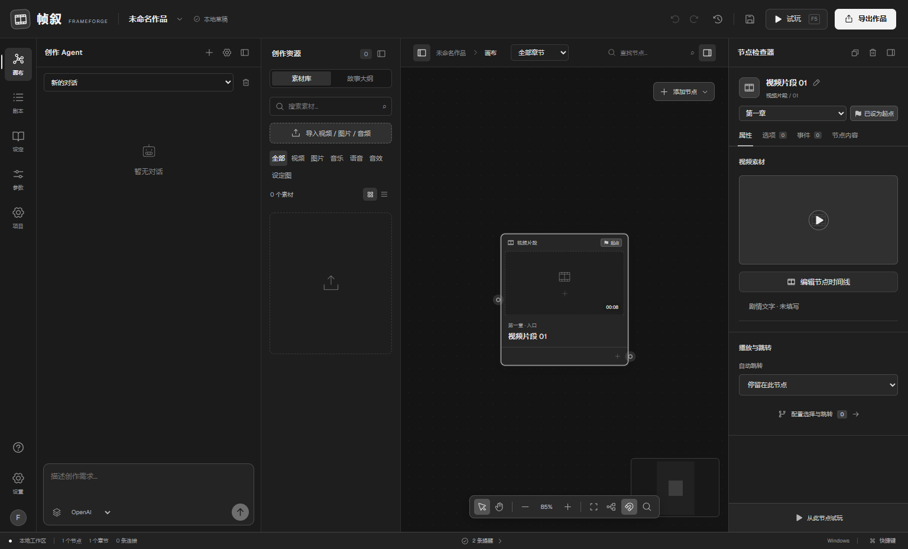
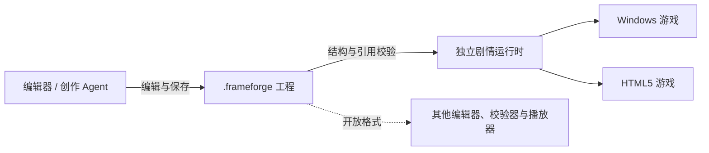

# 帧叙 · FrameForge

**本地互动影游创作工具，也是一个开放的互动影游数据协议项目。**

观众按下一个选项，同一场戏就有了另一个未来。一个角色是否回来，一句台词是否被听见，甚至上一次选择留下的后果，都能在下一幕得到回应。互动影游让编剧和导演有机会创作这样的作品，也让每个玩家用自己的选择参与叙事。

我们相信这个媒介还有广阔的空间。互动短剧、游戏叙事、动画和独立影像都可以借用彼此的创作方法。要让这样的合作走得更远，一份作品需要能在不同的工具里被打开、理解、验证和播放。创作者应该能带着自己的章节、分支、规则和素材继续工作，也能把作品交给别人接着做。

**帧叙的长期目标，是和创作者、编辑器与播放器开发者一起建立一套开放、可实现、可验证的互动影游标准数据协议范式。** 你可以用帧叙剪辑和试玩一部作品，也可以拿它的工程数据写一个新播放器，或者给自己的工具接入导入导出。每次独立实现，都能帮助我们把协议写得更准确。

[下载 Windows 版](https://github.com/Sheldon23357/FrameForge/releases) · [工程格式提案](docs/project-format.md) · [参与讨论](https://github.com/Sheldon23357/FrameForge/issues)



## 一份作品，贯穿制作与播放



协议要表达的不只是场景之间连了哪根线。它还要说明选项何时出现、属性怎样变化、道具何时消耗、分支以什么顺序判定，以及存档恢复后哪些事件仍可触发。帧叙把这些规则连同媒体引用写进有版本号的工程文件。编辑器、试玩和两种导出共用核心剧情状态机，规则可以直接用测试核对。

目前的参考实现使用 **工程格式 v4**。这份格式已经用于保存、迁移、校验和导出，跨工具互操作仍处在提案阶段。字段、规则语义和兼容性约定见[工程格式提案](docs/project-format.md)。

## 帧叙现在能做什么

- **组织互动叙事**。用章节、视频节点、条件分支和结局搭出蓝图。通过属性、道具、节点访问记录与组合条件控制走向。
- **把片段剪成可以试玩的场景**。在节点时间线上拼接视频和图片，安排对白、音乐、选项和事件的时间点，从任意节点开始检查剧情。
- **让玩家带着选择继续前进**。播放器支持剧情路线、条件选项、自动存档和手动存读档。开发时可检查运行状态和事件记录。
- **把游戏交到玩家手里**。导出独立 Windows 游戏，或导出可以部署到静态网站的 HTML5 目录。玩家无需安装编辑器。
- **按需接入创作 Agent**。桌面版支持配置 OpenAI、Gemini、DeepSeek、MiniMax 或本机 Codex CLI。Agent 通过注册工具读取和修改工程，修改经校验后一次提交，支持整轮撤销。

## 开始制作

1. 在 [Releases](https://github.com/Sheldon23357/FrameForge/releases) 下载 Windows x64 便携 ZIP，解压整个目录后运行 `FrameForge.exe`。
2. 打开后直接进入空白工程。导入自己的视频或图片，将素材拖入蓝图，再添加节点、选项和连线。
3. 按 **F5** 试玩。保存时保留工程文件和同目录的素材。点击「导出作品」生成 Windows 或 HTML5 游戏。

编辑、试玩与导出可离线进行。模型能力在桌面版「设置 → 模型设置」中按需启用，使用自己的帐号或 API 密钥。便携版在可写目录内运行，详细操作、模型设置和网页部署见[使用说明](docs/editor-guide.md)。

## 从源码运行

桌面参考环境为 Windows 11 x64、Node.js 24 LTS 和 npm。

```powershell
git clone https://github.com/Sheldon23357/FrameForge.git
cd FrameForge
npm ci
npm run dev
```

- `npm run dev:web` 启动浏览器开发预览，默认地址为 `http://127.0.0.1:5173`。
- `npm run typecheck` 和 `npm test` 检查类型与单元测试。
- `npm run build` 构建编辑器和独立网页播放器，`npm run package` 将 Windows 便携目录输出到 `release/win-unpacked`。
- `npm run test:e2e` 运行端到端测试，需要事先执行 `npm run build`，并安装 Chrome、FFmpeg 和 Electron 运行时。Electron 安装脚本被 npm 跳过时，执行 `node node_modules/electron/install.js`。

## 一起定义下一版

- **编剧、导演、剪辑师**可以反馈一个具体创作场景。例如你想怎样编排跨章伏笔，或哪里难以同时照顾拍摄流程和玩家选择。描述场景和规则就足够参与讨论。
- **播放器与工具开发者**可以从[工程格式](docs/project-format.md)和[纯 TypeScript 运行时](packages/runtime/)开始，试做一个读取器、验证器或导入器。欢迎在 Issue 里指出哪些结果还无法只靠协议推导出来。
- **想参与代码的人**可以提交一个小改动。改动剧情语义时，请同时覆盖 Schema、运行时与测试。涉及创作工具的改动可参考[创作 Agent 架构](docs/agent-architecture.md)。

希望有一天，同一部互动影游可以由不同的人、用不同的工具接力完成，最终在更多地方被玩到。欢迎带着你的创作需求或一个独立实现来一起做。

源码以 [MIT](LICENSE) 许可发布，版权归 Sheldon23357。随 Windows 版分发的第三方组件保留各自的许可与署名，详见[第三方许可](public/THIRD_PARTY_NOTICES.txt)。
